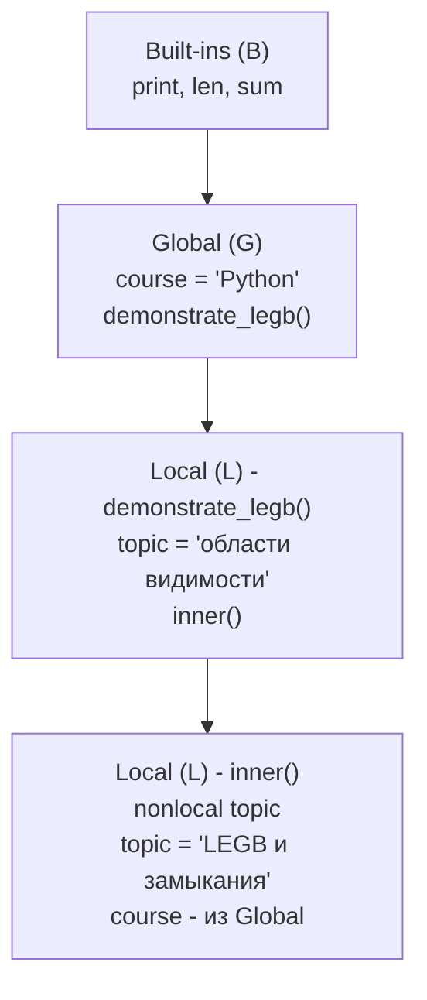

# Лабораторная работа № 3. Алгоритмы, коллекции и функции
## Цель работы
Научиться переводить условие задачи в алгоритм, выбирать подходящую структуру данных и разделять программу на небольшие функции с понятными контрактами.
## Задание 1. Условия и классификация данных
Запускаем код:
```python
a = int(input('Результат студента: '))
b = input('Тип работы: ')
c = int(input('Количество пропущенных занятий: '))
# часть 1
if (0 > a or a > 100):
    print('Данные о результатах студента неккоректны')
elif (c < 0 or c > 5):
    print('Данные о посещении неккоректны')
else:  # часть 2
    if 90 <= a:
        lev = 'отличный'
    elif 75 <= a:
        lev = 'хороший'
    elif 60 <= a:
        lev = 'удовлетворительный'
    else:
        lev = 'недостаточный'
    if c > 3:
        if lev == 'отличный':
            lev = 'хороший'
        elif lev == 'хороший':
            lev = 'удовлетворительный'
        elif lev == 'удовлетворительный':
            lev = 'недостаточный'
    match b:   # часть 3
        case 'exam':
            work = 'экзаменационная работа'
        case 'project':
            work = 'проектная работа'
        case 'practice':
            work = 'практическая работа'
        case _:
            work = 'неизвестный тип работы'
    print(f'Результат: {a}')
    print(f'Тип работы: {work}')
    print(f'Пропуски: {c}')
    print(f'Уровень: {lev}')
```
Таблица результатов:
<table>
    <tr>
        <th>Значения</th>
        <th>Ожидаемый результат</th>
        <th>Фактический результат</th>
    </tr>
    <tr>
        <td>a = 0; b = exam; c = 2</td>
        <td>Результат: 0; Тип работы: экзаменационная работа; Пропуски: 2; Уровень: недостаточный</td>
        <td>Результат: 0; Тип работы: экзаменационная работа; Пропуски: 2; Уровень: недостаточный</td>
    </tr>
    <tr>
        <td>a = 59; b = exam; c = 3</td>
        <td>Результат: 59; Тип работы: экзаменационная работа; Пропуски: 3; Уровень: недостаточный </td>
        <td>Результат: 59; Тип работы: экзаменационная работа; Пропуски: 3; Уровень: недостаточный </td>
    </tr>
    <tr>
        <td>a = 60; b = project; c = 5</td>
        <td>Результат: 60; Тип работы: проектная работа; Пропуски: 5; Уровень: недостаточный </td>
        <td>Результат: 60; Тип работы: проектная работа; Пропуски: 5; Уровень: недостаточный </td>
    </tr>
    <tr>
        <td>a = 74; b = project; c = 4</td>
        <td>Результат: 74; Тип работы: проектная работа; Пропуски: 4; Уровень: недостаточный</td>
        <td>Результат: 74; Тип работы: проектная работа; Пропуски: 4; Уровень: недостаточный</td>
    </tr>
    <tr>
        <td>a = 75; b = practice; c = 0</td>
        <td>Результат: 75; Тип работы: практическая работа; Пропуски: 0; Уровень: хороший</td>
        <td>Результат: 75; Тип работы: практическая работа; Пропуски: 0; Уровень: хороший</td>
    </tr>
    <tr>
        <td>a = 89; b = practice; c = 1</td>
        <td>Результат: 89; Тип работы: практическая работа; Пропуски: 1; Уровень: хороший</td>
        <td>Результат: 89; Тип работы: практическая работа; Пропуски: 1; Уровень: хороший</td>
    </tr>
    <tr>
        <td>a = 90; b = exam; c = 2</td>
        <td>Результат: 90; Тип работы: экзаменационная работа; Пропуски: 5; Уровень: хороший</td>
        <td>Результат: 90; Тип работы: экзаменационная работа; Пропуски: 5; Уровень: хороший</td>
    </tr>
    <tr>
        <td>a = 100; b = project; c = 5</td>
        <td>Результат: 100; Тип работы: проектная работа; Пропуски: 5; Уровень: хороший</td>
        <td>Результат: 100; Тип работы: проектная работа; Пропуски: 5; Уровень: хороший</td>
    </tr>
    <tr>
        <td>a = 110; b = project; c = 5</td>
        <td>Данные о результатах студента неккоректны</td>
        <td>Данные о результатах студента неккоректны</td>
    </tr>
</table>
Сначала проверяются допустимые диапазоны результата и количества пропусков. Если хотя бы одно значение некорректно, программа выводит сообщение об ошибке и не выполняет классификацию.

Затем уровень определяется по убыванию границ результата: сначала 90–100, затем 75–89, затем 60–74, и в ветви `else` — 0–59. Такой порядок делает условия компактными и исключает необходимость повторно проверять верхнюю границу каждого диапазона.

Если пропущено более трёх занятий, уровень понижается на одну ступень. Для уровня «недостаточный» понижение невозможно, поэтому значение остаётся прежним.

После этого конструкция `match / case` формирует пояснение по типу работы. Ветка `case _:` обрабатывает неизвестные значения.

При проверке от больших значений к меньшим ветвь для диапазона 90–100 проверяется первой. Поэтому в последующих условиях значения из этого диапазона уже не встретятся: например, отдельная проверка `a <= 100` после `a >= 90` была бы бессмысленной. 


Аналогично, после проверки `a >= 75` отдельная проверка `a < 90` не нужна, а после проверки `a >= 60` не нужна проверка `a < 75`. Ветка `else` для результата корректно обрабатывает все значения от 0 до 59.
### Практическое расширение
Ожидаемая итоговая сводка для встроенного списка:
- отличный: 2
- хороший: 3
- удовлетворительный: 3
- недостаточный: 3
Запускаем код:
```python
# Практическое расширение
def f(score, work_type, absences):
    if score >= 90:
        level = "отличный"
    elif score >= 75:
        level = "хороший"
    elif score >= 60:
        level = "удовлетворительный"
    else:
        level = "недостаточный"

    if absences > 3:
        if level == "отличный":
            level = "хороший"
        elif level == "хороший":
            level = "удовлетворительный"
        elif level == "удовлетворительный":
            level = "недостаточный"

    match work_type:
        case "exam":
            work = "экзаменационная работа"
        case "project":
            work = "проектная работа"
        case "practice":
            work = "практическая работа"
        case _:
            work = "неизвестный тип работы"
    if score >= 90:
        level = "отличный"
    elif score >= 75:
        level = "хороший"
    elif score >= 60:
        level = "удовлетворительный"
    else:
        level = "недостаточный"

    if absences > 3:
        if level == "отличный":
            level = "хороший"
        elif level == "хороший":
            level = "удовлетворительный"
        elif level == "удовлетворительный":
            level = "недостаточный"

    match work_type:
        case "exam":
            work_description = "экзаменационная работа"
        case "project":
            work_description = "проектная работа"
        case "practice":
            work_description = "практическая работа"
        case _:
            work_description = "неизвестный тип работы"

    return (f"Результат: {score}; тип работы: {work_description}; пропуски: {absences}; уровень: {level}.")
student = [(95, 'exam', 0), (88, 'project', 2), (72, 'practice', 1), (58, 'exam', 0), (91, 'project', 4), (76, 'practice', 5), (63, 'exam', 4), (45, 'project', 0), (100, 'practice', 0), (67, 'exam', 2), (83, 'project', 3),]
lev_count = {
    'отличный': 0,
    'хороший': 0,
    'удовлетворительный': 0,
    'недостаточный': 0
}
for x in student:
    res = f(*x)
    print(res)
    for y in lev_count:
        if res.endswith(f'уровень: {y}.'):
            lev_count[y] += 1
            break
for x, y in lev_count.items():
    print(f'{x}: {y}')
```
Результат:
```text
Результат: 95; тип работы: экзаменационная работа; пропуски: 0; уровень: отличный.
Результат: 88; тип работы: проектная работа; пропуски: 2; уровень: хороший.
Результат: 72; тип работы: практическая работа; пропуски: 1; уровень: удовлетворительный.
Результат: 58; тип работы: экзаменационная работа; пропуски: 0; уровень: недостаточный.
Результат: 91; тип работы: проектная работа; пропуски: 4; уровень: хороший.
Результат: 76; тип работы: практическая работа; пропуски: 5; уровень: удовлетворительный.
Результат: 63; тип работы: экзаменационная работа; пропуски: 4; уровень: недостаточный.
Результат: 45; тип работы: проектная работа; пропуски: 0; уровень: недостаточный.
Результат: 100; тип работы: практическая работа; пропуски: 0; уровень: отличный.
Результат: 67; тип работы: экзаменационная работа; пропуски: 2; уровень: удовлетворительный.
Результат: 83; тип работы: проектная работа; пропуски: 3; уровень: хороший.
отличный: 2
хороший: 3
удовлетворительный: 3
недостаточный: 3
```
Программа обрабатывает список из 11 записей `(score, work_type, absences)`. Исходные записи не изменяются: для каждой формируется отдельная строка результата, после чего подсчитывается количество студентов каждого уровня.

## Задание 2. Циклы и базовые алгоритмические схемы
Запускаем код:
```python
measurements = [12, 15, 11, 18, 18, 9, 21, 15, 7, 18]
minn = 100
maxx = 0
summ = 0
chet_count = 0
arif = 0
for x in measurements:
    if x < minn:
        minn = x
    if x > maxx:
        maxx = x
    summ += x
    if x % 2 == 0:
        chet_count += 1
arif_chislo = summ / len(measurements)
for x in measurements:
    if x > arif_chislo:
        arif += 1
print('Сумма:', summ)
print('Минимальное значение:', minn)
print('Максимальное значение:', maxx)
print('Количество чётных значений:', chet_count)
print('Числа превосходящие ср. ариф.:', arif)
a = int(input('Введите число: '))
ind = -1
for i in range(len(measurements)):
    if measurements[i] == a:
        ind = i
        break
if ind == -1:
    print(f'Число {a} отсутствует в списке')
else:
    print(f'Первое вхождение числа {a} в списке под индексом {ind}')
```
Результат:
```text
Сумма: 144
Минимальное значение: 7
Максимальное значение: 21
Количество чётных значений: 4
Числа превосходящие ср. ариф.: 6
Введите число: 9
Первое вхождение числа 9 в списке под индексом 5
```
Решение разделено на этапы. За первый проход по списку вычисляются сумма, минимальное и максимальное значения, а также количество чётных элементов. Затем определяется среднее арифметическое, и за второй проход подсчитываются значения, превышающие его. Для поиска введённого числа используется линейный поиск: выводится индекс первого вхождения, а если число отсутствует - -1. Запрещённые встроенные функции не используются.
### Дополнительный алгоритмический эксперимент
Запускаем код:
```python
number = int(input('Введите положительное целое число для проверки простоты: '))
def f(n):
    if n < 2:
        return False
    if n == 2:
        return True
    if n % 2 == 0:
        return False
    s = 3
    while s <= n ** 0.5:
        if n % s  == 0:
            return False
        s += 2
    return True
if f(number):
    print(f'Число {number} является простым')
else:
    print(f'Число {number} не является простым')
```
Результат:
```text
Введите положительное целое число для проверки простоты: 57
Число 57 не является простым
```
Временная сложность алгоритма в худшем случае - O(n ** 0.5), где n - проверяемое число. После отдельной проверки делимости на 2 алгоритм перебирает только нечётные делители от 3 до n включительно. В худшем случае, например для простого числа, выполняется примерно (n ** 0.5)/2 проверок. Постоянный множитель 1/2 не учитывается в обозначении O, поэтому сложность остаётся O(n ** 0.5). 
В лучшем случае сложность - O(1). 

Алгоритму требуется O(1) дополнительной памяти: используются только отдельные переменные, а вспомогательные списки и рекурсия отсутствуют.

Если число n составное, его можно представить как n=a⋅b, где a>1 и b>1. Хотя бы один из этих множителей не превосходит (n ** 0.5). Если бы оба были больше (n ** 0.5), их произведение было бы больше n, что невозможно.

### Практическое расширение
Запускаем код:
```python
import time
def liner_search(a1, x):
    comp = 0
    for i in range(len(a1)):
        comp += 1
        if a1[i] == x:
            return i, comp
    return -1, comp
def binari_search(a1, x):
    comp = 0
    lef = 0
    rig = len(a1) - 1
    while lef <= rig:
        mid = (lef + rig) // 2
        comp += 1
        if a1[mid] == x:
            return mid, comp
        comp += 1
        if a1[mid] < x:
            lef = mid + 1
        else:
            rig = mid - 1
    return -1, comp
a10 = [i for i in range(1, 11)]
a100 = [i for i in range(1, 101)]
a1000 = [i for i in range(1, 1001)]

print('Линейный поиск для 10 элементов:')
start = time.perf_counter()
lin10, comp10 = liner_search(a10, 10)
end = time.perf_counter()
print (f'Время выполнения: {(end - start):.6f} сек')
print('Колличество сравнений:', comp10)

print('Линейный поиск для 100 элементов:')
start = time.perf_counter()
lin100, comp100 = liner_search(a100, 100)
end = time.perf_counter()
print (f'Время выполнения: {(end - start):.6f} сек')
print('Колличество сравнений:', comp100)

print('Линейный поиск для 1000 элементов:')
start = time.perf_counter()
lin1000, comp1000 = liner_search(a1000, 1000)
end = time.perf_counter()
print (f'Время выполнения: {(end - start):.6f} сек')
print('Колличество сравнений:', comp1000)

print('Бинарный поиск для 10 элементов:')
start = time.perf_counter()
bin10, com10 = binari_search(a10, 10)
end = time.perf_counter()
print (f'Время выполнения: {(end - start):.6f} сек')
print('Колличество сравнений:', com10)

print('Бинарный поиск для 100 элементов:')
start = time.perf_counter()
bin100, com100 = binari_search(a100, 100)
end = time.perf_counter()
print (f'Время выполнения: {(end - start):.6f} сек')
print('Колличество сравнений:', com100)

print('Бинарный поиск для 10000 элементов:')
start = time.perf_counter()
bin1000, com1000 = binari_search(a1000, 1000)
end = time.perf_counter()
print (f'Время выполнения: {(end - start):.6f} сек')
print('Колличество сравнений:', com1000)
```
Результат:

Линейный поиск:
<table>
    <tr>
        <th>Количество элементов в списке</th>
        <th>Время</th>
        <th>Количество сравнений</th>
    </tr>
    <tr>
        <th>10</th>
        <th>0.000009 сек</th>
        <th>10</th>
    </tr>
    <tr>
        <th>100</th>
        <th>0.000020 сек</th>
        <th>100</th>
    </tr>
    <tr>
        <th>1000</th>
        <th>0.000183 сек</th>
        <th>1000</th>
    </tr>
</table>
Бинарный поиск:
<table>
    <tr>
        <th>Количество элементов в списке</th>
        <th>Время</th>
        <th>Количество сравнений</th>
    </tr>
    <tr>
        <th>10</th>
        <th>0.000006 сек</th>
        <th>7</th>
    </tr>
    <tr>
        <th>100</th>
        <th>0.00005 сек</th>
        <th>13</th>
    </tr>
    <tr>
        <th>1000</th>
        <th>0.000011 сек</th>
        <th>19</th>
    </tr>
</table>
В выбранных случаях линейный поиск просматривает весь список. Бинарный на каждом шаге сокращает область поиска примерно вдвое, поэтому число сравнений растёт значительно медленнее. Это соответствует линейной и логарифмической сложности соответственно.
Временная сложность линейного и бинарного поиска:
- Линейный поиск: `O(n)` в худшем и среднем случаях.
- Бинарный поиск: `O(log(n))` в худшем и среднем случаях.
Дополнительная память: O(1) у обоих алгоритмов. 
Для измерения времени выполнения алгоритмов была подключена стандартная библиотека time с помощью import time. Из неё используется функция time.perf_counter(): она возвращает показание высокоточного таймера. Время выполнения вычисляется как разность показаний таймера до и после вызова алгоритма.

## Задание 3. Коллекции и выбор структуры данных
Запускаем код:
```python
submissions = [
    ("anna", "lab_01", 5),
    ("boris", "lab_01", 4),
    ("anna", "lab_02", 5),
    ("daria", "lab_01", 3),
    ("boris", "lab_02", 5),
    ("anna", "lab_01", 4),
]
students = set()
lab = set()
sl_pop = {}
sl_best_res = {}
sl_pop2 = {}
for st, labor, score in submissions:
    students.add(st)
    lab.add(labor)
    if st not in sl_pop:
        sl_pop[st] = []
    sl_pop[st].append(score)
    key = (st, labor)
    if (key not in sl_best_res) or (score > sl_best_res[key]):
        sl_best_res[key] = score
    sl_pop2[key] = sl_pop2.get(key, 0) + 1

def f(st, labor, score):
    students.add(st)
    lab.add(labor)
    if st not in sl_pop:
        sl_pop[st] = []
    sl_pop[st].append(score)
    key = (st, labor)
    if (key not in sl_best_res) or (score > sl_best_res[key]):
        sl_best_res[key] = score
    sl_pop2[key] = sl_pop2.get(key, 0) + 1
def f1():
    print('Студенты:', students)
    print('Лабораторные работы:', lab)
    print('Попытки студентов:', sl_pop)
    print('Лучшие результаты:', sl_best_res)
    print('Количество попыток:', sl_pop2)
    students_lab_01 = set()
    students_lab_02 = set()
    students_both_labs = set()
    for student, laboratory in sl_pop2:
        if laboratory == "lab_01":
            students_lab_01.add(student)
        elif laboratory == "lab_02":
            students_lab_02.add(student)
        students_both_labs = students_lab_01 & students_lab_02
    print("Студенты, сдавшие обе работы:", students_both_labs)
print('До изменений:')
f1()
print('После:')
f('daria', 'lab_02', 4)
f1()
```
Результат:
```text
До изменений:
Студенты: {'daria', 'anna', 'boris'}
Лабораторные работы: {'lab_02', 'lab_01'}
Попытки студентов: {'anna': [5, 5, 4], 'boris': [4, 5], 'daria': [3]}
Лучшие результаты: {('anna', 'lab_01'): 5, ('boris', 'lab_01'): 4, ('anna', 'lab_02'): 5, ('daria', 'lab_01'): 3, ('boris', 'lab_02'): 5}
Количество попыток: {('anna', 'lab_01'): 2, ('boris', 'lab_01'): 1, ('anna', 'lab_02'): 1, ('daria', 'lab_01'): 1, ('boris', 'lab_02'): 1}
Студенты, сдавшие обе работы: {'anna', 'boris'}
После:
Студенты: {'daria', 'anna', 'boris'}
Лабораторные работы: {'lab_02', 'lab_01'}
Попытки студентов: {'anna': [5, 5, 4], 'boris': [4, 5], 'daria': [3, 4]}
Лучшие результаты: {('anna', 'lab_01'): 5, ('boris', 'lab_01'): 4, ('anna', 'lab_02'): 5, ('daria', 'lab_01'): 3, ('boris', 'lab_02'): 5, ('daria', 'lab_02'): 4}
Количество попыток: {('anna', 'lab_01'): 2, ('boris', 'lab_01'): 1, ('anna', 'lab_02'): 1, ('daria', 'lab_01'): 1, ('boris', 'lab_02'): 1, ('daria', 'lab_02'): 1}
Студенты, сдавшие обе работы: {'daria', 'anna', 'boris'}
```
Множество подходит для хранения уникальных значений, потому что при добавлении элемента оно автоматически не сохраняет повторения. Например, anna встречается в исходных данных несколько раз, но в students останется один раз. Поиск элемента в множестве в среднем выполняется за O(1).
Кортеж можно использовать как ключ словаря, потому что он неизменяем и, если все его элементы хешируемы, имеет корректный хеш. Ключ `(student, laboratory)` объединяет два строковых значения в один составной ключ.
Список нельзя использовать как ключ словаря, потому что он изменяемый и не является хешируемым. Если бы список можно было изменить после добавления в словарь, его хеш и расположение в хеш-таблице перестали бы соответствовать сохранённому ключу.
Словарь предпочтительнее списка для частого поиска результата по составному ключу, так как поиск по ключу в словаре в среднем занимает O(1). Поиск нужной пары `(student, laboratory)` в списке потребовал бы просмотра элементов и в худшем случае занял бы O(n).
### Практическое расширение
Запускаем код:
```python
def f2(s):
    parts = s.strip().split()
    if not parts:
        print('Пустой запрос')
        return 1
    com = parts[0]
    if com == 'student' and len(parts) == 2:
        student = parts[1]
        if student in sl_pop:
            print(f'Попытки {student}: {sl_pop[student]}')
        else:
            print(f'Студент {student} не найден')
    elif com == 'best' and len(parts) == 3:
        student, laboratory = parts[1], parts[2]
        key = (student, laboratory)
        if key in sl_best_res:
            print(f"Лучший результат {student} по {laboratory}: {sl_best_res[key]}")
        else:
            print(f"Нет попыток {student} по {laboratory}")
    elif com == "attempts" and len(parts) == 3:
        student, laboratory = parts[1], parts[2]
        key = (student, laboratory)
        if key in sl_pop2:
            print(f"Попыток {student} по {laboratory}: {sl_pop2[key]}")
        else:
            print(f"Нет попыток {student} по {laboratory}")
    elif com == "completed" and len(parts) == 2:
        laboratory = parts[1]
        if laboratory in lab:
            students_for_lab = set()
            for student, lab1 in sl_pop2:
                if lab1 == laboratory:
                    students_for_lab.add(student)
            print(f"Сдавали {laboratory}: {students_for_lab}")
        else:
            print(f"Лабораторная работа {laboratory} не найдена")
    else:
        print("Неизвестная команда или неверный формат запроса")
print('Примеры запросов:')
f2('student anna')
f2('best anna lab_01')
f2('attempts boris lab_02')
f2('completed lab_01')
f2('completed lab_03')
f2('bad anna')
```
Результат:
```text
Примеры запросов:
Попытки anna: [5, 5, 4]
Лучший результат anna по lab_01: 5
Попыток boris по lab_02: 1
Сдавали lab_01: {'anna', 'boris', 'daria'}
Лабораторная работа lab_03 не найдена
Неизвестная команда или неверный формат запроса
```
Для работы с построенными данными реализованы текстовые запросы: `student`, `best`, `attempts` и `completed`. Введённая строка разделяется на части по пробелам, после чего программа определяет команду и выбирает нужную операцию. Команда `student` выводит список попыток студента, `best` — лучший результат по паре «студент — лабораторная работа», `attempts` — количество попыток, а `completed` — множество студентов, сдававших указанную работу.
## Задание 4. Функции, параметры и области видимости
Запускаем код:
```python
def arithmetic_mean(values: list[float]) -> float:
    """Возвращает среднее арифметическое непустого списка."""
    if not values:
        return 0.0
    return sum(values) / len(values)
# Проверки arithmetic_mean
assert arithmetic_mean([1, 2, 3]) == 2.0
assert arithmetic_mean([10.0, 20.0]) == 15.0
assert arithmetic_mean([5]) == 5.0
# Позиционный вызов
print(arithmetic_mean([4, 8, 15]))
def normalize_name(name: str) -> str:
    """Удаляет лишние пробелы и приводит каждую часть имени к нужному регистру."""
    if not name:
        return ""
    parts = [part.capitalize() for part in name.split() if part]
    return " ".join(parts)
# Проверки normalize_name
assert normalize_name("  дарья   стрепеткова ") == "Дарья Стрепеткова"
assert normalize_name("ANNA MARIE") == "Anna Marie"
assert normalize_name("   ") == ""
# Позиционный и именованный вызовы
print(normalize_name("  иван   петров "))
print(normalize_name(name="  МАРИЯ   иванова "))
def build_report(
    student: str,
    results: list[int],
    *,
    precision: int = 2,
    prefix: str = "Результат",
) -> str:
    """Формирует строковый отчет о результатах студента."""
    if not student or not results:
        return f"{prefix} для {student or 'неизвестного студента'} отсутствуют."
    average = arithmetic_mean(results)
    return (
        f"{prefix} студента {student}: "
        f"средний балл {average:.{precision}f} "
        f"по {len(results)} результатам."
    )
# Проверки build_report
assert build_report("Иван", [5, 4]) == (
    "Результат студента Иван: средний балл 4.50 по 2 результатам."
)

assert build_report("Иван", [5, 4], precision=0) == (
    "Результат студента Иван: средний балл 5 по 2 результатам."
)
assert build_report(student="Иван", results=[5, 4], prefix="Итог") == (
    "Итог студента Иван: средний балл 4.50 по 2 результатам."
)
# Позиционный вызов
print(build_report("Иван", [5, 4]))
# Именованный вызов
print(build_report(student="Иван", results=[5, 4], prefix="Итог"))
def collect_tags(*tags: str, lowercase: bool = True) -> tuple[str, ...]:
    """Возвращает очищенные теги без пустых значений и повторов."""
    cleaned_tags = []
    for tag in tags:
        if not tag:
            continue
        cleaned_tag = tag.strip()
        if not cleaned_tag:
            continue
        if lowercase:
            cleaned_tag = cleaned_tag.lower()
        if cleaned_tag not in cleaned_tags:
            cleaned_tags.append(cleaned_tag)
    return tuple(cleaned_tags)
# Проверки collect_tags
assert collect_tags(" Python ", "python", "AI") == ("python", "ai")
assert collect_tags("Python", lowercase=False) == ("Python",)
assert collect_tags("", "  ", "Data") == ("data",)
# Позиционный вызов
print(collect_tags(" Python ", "AI", "python"))
# Именованный вызов
print(collect_tags("Python", "AI", lowercase=False))
# Демонстрация распаковки списка через * и словаря через **
scores = [85, 90, 78]
options = {
    "precision": 1,
    "prefix": "Итог",
}
report = build_report("Дарья Стрепеткова", scores, **options)
assert report == (
    "Итог студента Дарья Стрепеткова: "
    "средний балл 84.3 по 3 результатам."
)
print(report)
```
Результат:
```text
Позиционный вызов
9.0
Позиционный и именованный вызовы
Иван Петров
Мария Иванова
Позиционный вызов
Результат студента Иван: средний балл 4.50 по 2 результатам.
Именованный вызов
Итог студента Иван: средний балл 4.50 по 2 результатам.
Позиционный вызов
('python', 'ai')
Именованный вызов
('Python', 'AI')
Итог студента Дарья Стрепеткова: средний балл 84.3 по 3 результатам.
```
В первой части реализованы четыре функции: `arithmetic_mean()`, `normalize_name()`, `build_report()` и `collect_tags()`. Функции не изменяют переданные коллекции, а создают новые значения для результата. Используется ранний `return`, если функция не может выполнить контракт, например при пустом списке в `arithmetic_mean()` или пустом имени и списке результатов в `build_report()`. В `build_report()` параметры `precision` и `prefix` находятся после `*`, поэтому их можно передавать только по имени. Распаковка списка выполняется через `*`, например в `collect_tags(*tags)`, а распаковка словаря — через `**`, например в `build_report("Дарья Стрепеткова", scores, **options)`. Для каждой функции добавлены не менее трех проверок через assert, которые размещены сразу после определения соответствующей функции.
### Исследование LEGB
Запускаем код:
```python
print('Исследование LEGB')
course = "Python"
def demonstrate_legb() -> str:
    """Показывает LEGB и изменение переменной объемлющей функции через nonlocal."""
    topic = "области видимости"

    def inner() -> str:
        nonlocal topic
        topic = "LEGB и замыкания"
        return f"{course}: {topic}"

    return inner()
legb_result = demonstrate_legb()
assert legb_result == "Python: LEGB и замыкания"
assert course == "Python"
print(legb_result)
```
Результат:
```text
Исследование LEGB
Python: LEGB и замыкания
```
Во второй части показывается, как Python ищет переменные по правилу LEGB. Есть глобальная переменная course, внешняя функция `demonstrate_legb()` и вложенная функция `inner()`. Внутри `inner()` написано `nonlocal topic`. Это значит, что вложенная функция изменяет переменную `topic`, которая находится в внешней функции `demonstrate_legb()`. Глобальная переменная course при этом не меняется.
Порядок поиска имени такой:
- `Local` - сначала Python ищет переменную в текущей функции.
- `Enclosing` - если не нашел, ищет в внешней функции.
- `Global` - если не нашел, ищет на уровне всего файла.
- `Built-ins` — если не нашел, ищет среди встроенных имен Python, например print или len.

В нашем примере:
- `topic` в inner() находится в внешней функции demonstrate_legb() и изменяется через nonlocal.
- `course` в inner() находится в глобальной области.
- `inner` находится в локальной области функции demonstrate_legb().
- `print`, если он используется, находится в области Built-ins.

Схема:

### Ошибка изменяемого значения по умолчанию
Запускаем код:
```python
print('Ошибка изменяемого значения по умолчанию')
def add_result(value: int, results: list[int] | None = None) -> list[int]:
    """Добавляет результат в новый или переданный список без общего состояния."""
    if results is None:
        results = []
    results.append(value)
    return results
first_result = add_result(1)
second_result = add_result(2)
assert first_result == [1]
assert second_result == [2]
assert first_result is not second_result
print(first_result)
print(second_result)
```
Результат:
```text
[1]
[2]
```
В третьей части рассматривается ошибка изменяемого значения по умолчанию. В исходной функции `add_result(value, results=[])` список [] создается только один раз — в момент выполнения def, а не при каждом вызове функции. Поэтому все вызовы без второго аргумента используют один и тот же список. При вызове `add_result(1)` в список добавляется 1, при следующем вызове `add_result(2)` добавляется 2 в тот же список, и так далее. В результате результаты накапливаются: [1], [1, 2], [1, 2, 3]. Ошибка возникает потому, что метод `append()` изменяет существующий список, а не создает новый. Чтобы исправить это, в качестве значения по умолчанию используют `None`, а внутри функции создают новый список, если `results` не передан. Теперь каждый вызов без аргумента `results` получает собственный новый список.
### Практическое расширение
Запускаем код:
```python
print('Практическое расширение')
def apply_to_results(
    operation,
    values,
):
    """Применяет переданную функцию к каждому результату."""
    return [operation(value) for value in values]
def double(value: int) -> int:
    """Удваивает переданное значение."""
    return value * 2
doubled_results = apply_to_results(double, [1, 2, 3])
incremented_results = apply_to_results(lambda value: value + 1, [1, 2, 3])
assert doubled_results == [2, 4, 6]
assert incremented_results == [2, 3, 4]
print(doubled_results)
print(incremented_results)
def make_threshold_checker(threshold: int):
    """Создает функцию для проверки достижения порога."""
    def check(result: int) -> bool:
        return result >= threshold
    return check
passed_80 = make_threshold_checker(80)
passed_90 = make_threshold_checker(90)
assert passed_80(85) is True
assert passed_90(85) is False
assert passed_80(90) is True
assert passed_90(90) is True
print(passed_80(85))
print(passed_90(85))
```
Результат:
```text
Практическое расширение
[2, 4, 6]
[2, 3, 4]
True
False
```
В пятой части реализованы функции `apply_to_results()` и `make_threshold_checker()`. Функция `apply_to_results(operation, values)` принимает другую функцию и последовательность результатов, а затем применяет переданную функцию к каждому элементу. В нее можно передать как именованную функцию, например double, так и лямбда-функцию, например `lambda value: value + 1`. Функция `make_threshold_checker(threshold)` создает и возвращает другую функцию check, которая проверяет, достиг ли результат заданного порога. В замыкании сохраняется значение параметра `threshold`, которое было передано при создании функции. Например, passed_80 = `make_threshold_checker(80)` сохраняет значение 80, а `passed_90 = make_threshold_checker(90)` сохраняет значение 90. Поэтому `passed_80(85)` вернет True, потому что 85 >= 80, а `passed_90(85)` вернет False, потому что 85 < 90. Каждая возвращенная функция «помнит» свое значение порога из замыкания.
## Задание 5. Анализатор учебных результатов
Запускаем код:
```python
students = {
    "Анна": [78, 91, 84, 88],
    "Борис": [60, 72, 68],
    "Дарья": [95, 93, 97, 90],
    "Илья": [55, 61],
}
def mean(values):  #Средн ариф
    if not values:
        return 0.0

    return sum(values) / len(values)
def minimum(values):   #мин балл
    if not values:
        return None
    result = values[0]
    for value in values[1:]:
        if value < result:
            result = value
    return result
def maximum(values):   #макс балл
    if not values:
        return None
    result = values[0]
    for value in values[1:]:
        if value > result:
            result = value
    return result
def classify(score):     #оценка текстовая
    if score >= 90:
        return "отлично"
    if score >= 75:
        return "хорошо"
    if score >= 60:
        return "удовлетворительно"
    return "неудовлетворительно"
def student_summary(name, results):   #словарь со всеми итогами 1го студента
    average = mean(results)
    lowest = minimum(results)
    highest = maximum(results)
    return {
        "name": name,
        "results": results.copy(),
        "average": average,
        "minimum": lowest,
        "maximum": highest,
        "category": classify(average),
    }
def group_summary(students):     #статистика текстовых оценок
    summaries = []
    for name, results in students.items():
        summaries.append(student_summary(name, results))
    categories = {
        "отлично": 0,
        "хорошо": 0,
        "удовлетворительно": 0,
        "неудовлетворительно": 0,
    }
    for summary in summaries:
        categories[summary["category"]] += 1
    all_results = []
    for results in students.values():
        all_results.extend(results)
    return {
        "students": summaries,
        "categories": categories,
        "group_average": mean(all_results),
    }
def find_top_students(students):   #студент с макс ср результатом
    if not students:
        return []
    top_average = None
    top_students = []
    for name, results in students.items():
        average = mean(results)
        if top_average is None or average > top_average:
            top_average = average
            top_students = [name]
        elif average == top_average:
            top_students.append(name)
    return top_students
def format_report(student_data, group_data):    #общий итоговый отчет
    if not student_data:
        return "Группа пуста."
    lines = ["Отчет по учебным результатам", ""]
    for student in student_data:
        lines.append(f"Студент: {student['name']}")
        lines.append(f"Средний результат: {student['average']:.2f}")
        lines.append(f"Минимальный результат: {student['minimum']}")
        lines.append(f"Максимальный результат: {student['maximum']}")
        lines.append(f"Категория: {student['category']}")
        lines.append("")
    lines.append("Количество студентов по категориям:")
    for category, count in group_data["categories"].items():
        lines.append(f"{category}: {count}")
    lines.append("")
    lines.append(f"Общий средний результат группы: {group_data['group_average']:.2f}")
    top_students = find_top_students({
        student["name"]: student["results"]
        for student in student_data
    })
    if top_students:
        lines.append(f"Лидеры группы: {', '.join(top_students)}")
    return "\n".join(lines)
#пример 1
group_data = group_summary(students)
student_data = group_data["students"]
report = format_report(student_data, group_data)
print(report)
print()
#пример 2
students1 = {
    "Анна": [78, 91, 84, 88],
}
group_data1 = group_summary(students1)
student_data1 = group_data1["students"]
report1 = format_report(student_data1, group_data1)
print(report1)
print()
#пример 3
students2 = {
    "Анна": [78, 91, 84, 88],
    "Борис": [90, 83, 68, 100],
    "Дарья": [50, 51],
}
group_data2 = group_summary(students2)
student_data2 = group_data2["students"]
report2 = format_report(student_data2, group_data2)
print(report2)
print()
#пример 4
students3 = {}
group_data3 = group_summary(students3)
student_data3 = group_data3["students"]
report3 = format_report(student_data3, group_data3)
print(report3)
print()
# Пример 5
students4 = {
    "Анна": [],
    "Борис": [90, 83, 68, 100],
    "Дарья": [50, 51],
}
group_data4 = group_summary(students4)
student_data4 = group_data4["students"]
report4 = format_report(student_data4, group_data4)
print(report4)
print()
# Пример 6
students5 = {
    "Анна": [0],
    "Борис": [100],
}
group_data5 = group_summary(students5)
student_data5 = group_data5["students"]
report5 = format_report(student_data5, group_data5)
print(report5)
print()
```
Результат:
```text
Отчет по учебным результатам

Студент: Анна
Средний результат: 85.25
Минимальный результат: 78
Максимальный результат: 91
Категория: хорошо

Студент: Борис
Средний результат: 66.67
Минимальный результат: 60
Максимальный результат: 72
Категория: удовлетворительно

Студент: Дарья
Средний результат: 93.75
Минимальный результат: 90
Максимальный результат: 97
Категория: отлично

Студент: Илья
Средний результат: 58.00
Минимальный результат: 55
Максимальный результат: 61
Категория: неудовлетворительно

Количество студентов по категориям:
отлично: 1
хорошо: 1
удовлетворительно: 1
неудовлетворительно: 1

Общий средний результат группы: 79.38
Лидеры группы: Дарья

Отчет по учебным результатам

Студент: Анна
Средний результат: 85.25
Минимальный результат: 78
Максимальный результат: 91
Категория: хорошо

Количество студентов по категориям:
отлично: 0
хорошо: 1
удовлетворительно: 0
неудовлетворительно: 0

Общий средний результат группы: 85.25
Лидеры группы: Анна

Отчет по учебным результатам

Студент: Анна
Средний результат: 85.25
Минимальный результат: 78
Максимальный результат: 91
Категория: хорошо

Студент: Борис
Средний результат: 85.25
Минимальный результат: 68
Максимальный результат: 100
Категория: хорошо

Студент: Дарья
Средний результат: 50.50
Минимальный результат: 50
Максимальный результат: 51
Категория: неудовлетворительно

Количество студентов по категориям:
отлично: 0
хорошо: 2
удовлетворительно: 0
неудовлетворительно: 1

Общий средний результат группы: 78.30
Лидеры группы: Анна, Борис

Группа пуста.

Отчет по учебным результатам

Студент: Анна
Средний результат: 0.00
Минимальный результат: None
Максимальный результат: None
Категория: неудовлетворительно

Студент: Борис
Средний результат: 85.25
Минимальный результат: 68
Максимальный результат: 100
Категория: хорошо

Студент: Дарья
Средний результат: 50.50
Минимальный результат: 50
Максимальный результат: 51
Категория: неудовлетворительно

Количество студентов по категориям:
отлично: 0
хорошо: 1
удовлетворительно: 0
неудовлетворительно: 2

Общий средний результат группы: 73.67
Лидеры группы: Борис

Отчет по учебным результатам

Студент: Анна
Средний результат: 0.00
Минимальный результат: 0
Максимальный результат: 0
Категория: неудовлетворительно

Студент: Борис
Средний результат: 100.00
Минимальный результат: 100
Максимальный результат: 100
Категория: отлично

Количество студентов по категориям:
отлично: 1
хорошо: 0
удовлетворительно: 0
неудовлетворительно: 1

Общий средний результат группы: 50.00
Лидеры группы: Борис
```
`mean(values)` принимает список чисел и возвращает их среднее арифметическое. Если список пустой, функция возвращает 0.0.

`minimum(values)` принимает список чисел и возвращает наименьшее значение без использования `min()`. Если список пустой, функция возвращает None.

`maximum(values)` принимает список чисел и возвращает наибольшее значение без использования `max()`. Если список пустой, функция возвращает `None`.

`classify(score)` принимает число — средний результат студента — и возвращает текстовую категорию: «отлично», «хорошо», «удовлетворительно» или «неудовлетворительно». Если результат меньше 60, возвращается «неудовлетворительно».

`student_summary(name, results)` принимает имя студента и список его результатов. Возвращает словарь с именем, результатами, средним, минимальным и максимальным значением, а также категорией. Если список результатов пустой, среднее равно 0.0, а минимум и максимум равны `None`.

`group_summary(students)` принимает словарь студентов, где ключ — имя, а значение — список результатов. Возвращает общую статистику группы: список итогов по каждому студенту, количество студентов в каждой категории и общий средний результат. Если словарь пустой, список студентов пустой, а общий средний результат равен 0.0.

`find_top_students(students)` принимает словарь студентов и возвращает список имен студентов с наибольшим средним результатом. Если несколько студентов имеют одинаковое максимальное среднее, в список попадают все они. Если группа пустая, возвращается пустой список.

`format_report(student_data, group_data)` принимает список итогов студентов и общую статистику группы. Возвращает готовый текстовый отчет. Если список студентов пустой, возвращается строка «Группа пуста.».

Программа разделена на небольшие функции: базовые расчеты выполняют `mean()`, `minimum()` и `maximum()`, категорию определяет `classify()`, данные одного студента формирует `student_summary()`, общую статистику группы — `group_summary()`, лидеров находит `find_top_students()`, а итоговый текст создает `format_report()`. Такая декомпозиция упрощает проверку каждой части программы отдельно.

Сложность построения общей статистики составляет O(n), где n - общее количество результатов всех студентов. 
